  

  
  
  

  

  

---

## Skills & Tools

  
  
  
  
  
  

## Projects

  
  
  
  
  
  
  

More on [my repositories tab](https://github.com/karim-maher-cys?tab=repositories).

## GitHub Stats

  
  

  

---

  

